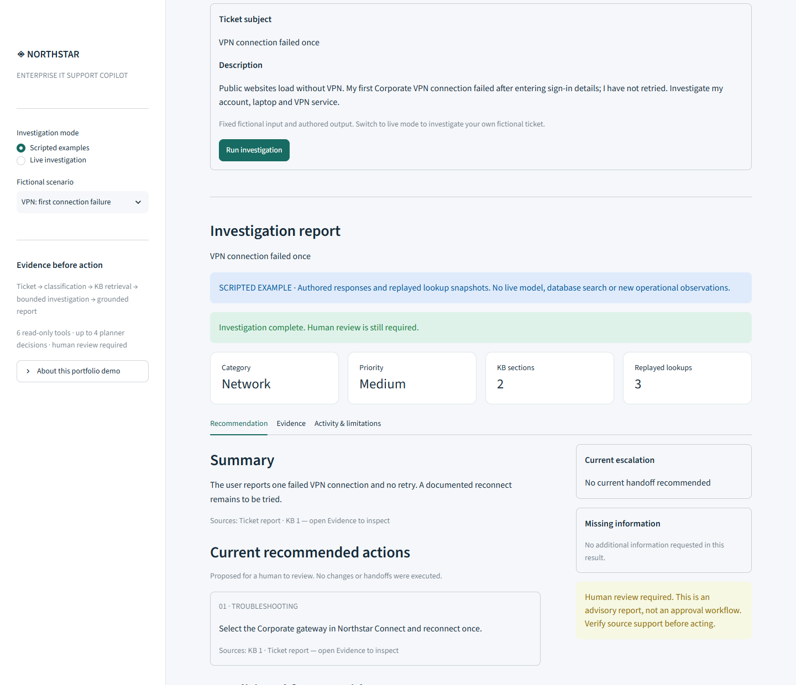
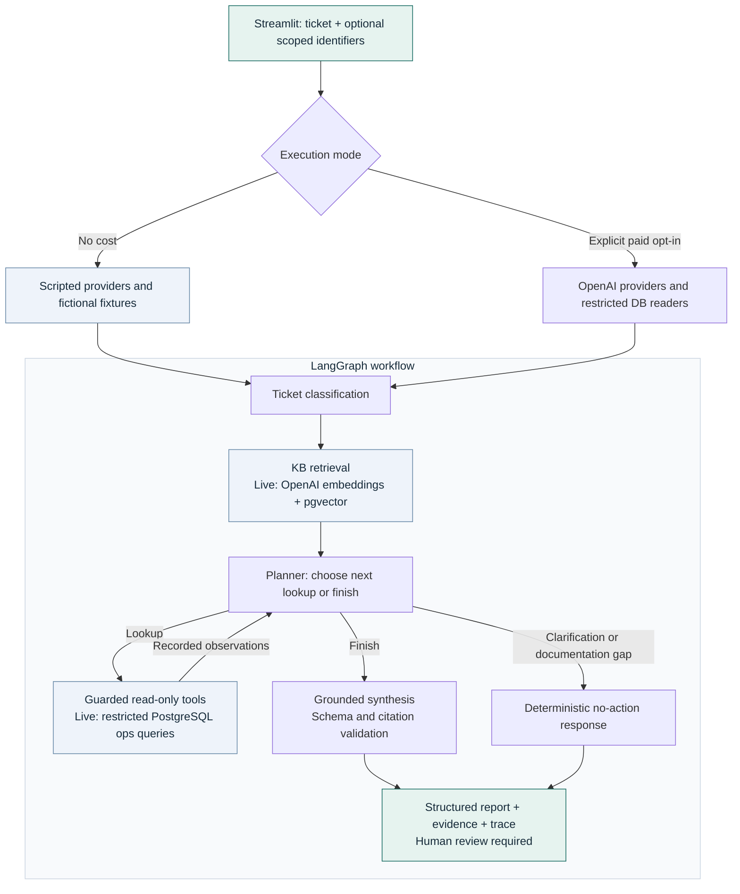
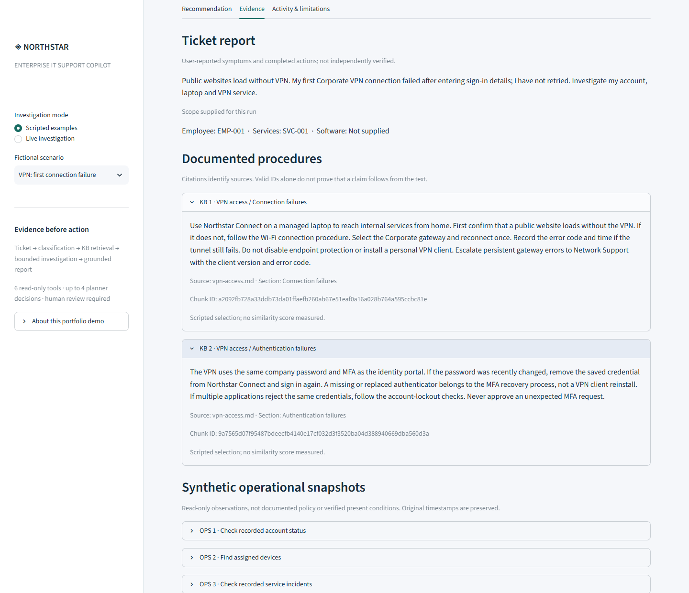
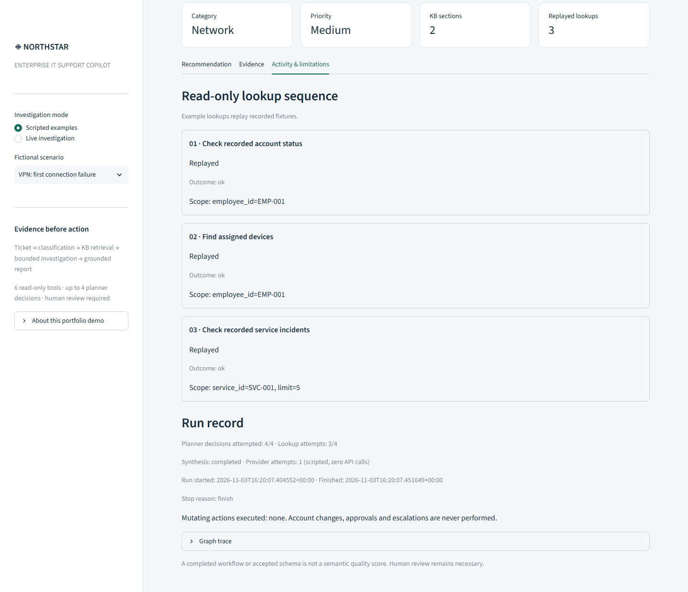
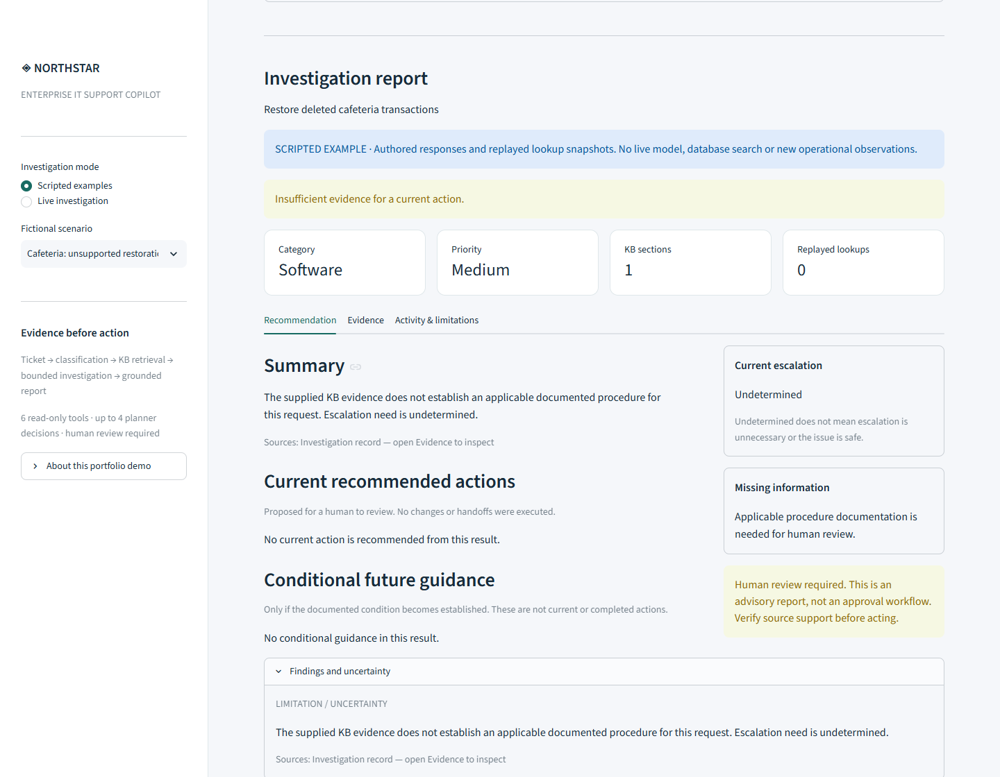

# Enterprise IT Support Copilot

A local AI Engineer portfolio project that turns an IT support ticket into a
structured, evidence-grounded investigation report. It combines ticket
classification, retrieval over a fictional internal knowledge base, and a bounded
LangGraph planner with six read-only operational tools. The Streamlit demo makes
the recommendations, sources, uncertainty and investigation trace inspectable.
All outputs are advisory; the application never changes accounts or executes handoffs.



*Actual application in no-cost scripted mode. Responses are authored examples,
not fresh live-model inference.*

[Run the demo](#quick-start-no-cost) · [Architecture](#architecture) ·
[Evaluation](#evaluation-and-verification) · [Technical documentation](docs/README.md)

## What it does

- Classifies ticket subject and description into category, priority and summary.
- Retrieves Markdown KB sections with source paths, headings and chunk IDs.
- Plans bounded lookups of account, device, entitlement, ticket and incident records.
- Separates documented procedures, ticket-reported facts and recorded operational
  observations in a structured report with validated evidence references.
- Distinguishes current actions from conditional future guidance, and supports
  clarification, documentation-gap abstention and partial results.

| Capability | Standalone RAG | Investigation workflow |
| --- | --- | --- |
| Ticket + retrieved KB procedures | Yes | Yes |
| Operational context | None | Scoped, read-only lookups chosen by the planner |
| Output | Cited support recommendation | Recommendation, typed evidence and ordered lookup trace |

Both paths remain available independently. Added operational context and planning
do not establish better answer quality; the measured comparison is reported below.

## Architecture



The examples use the same graph and validators with scripted providers and
fictional snapshots. Live mode uses OpenAI query embeddings and pgvector cosine
search (top three chunks), then permits at most four planner decisions and four
lookup attempts by default. Failures preserve available evidence and error records.
The [graph guide](docs/phase4.md) explains the guards and partial-result semantics.

**Technology:** Python 3.11+, Pydantic, OpenAI Structured Outputs, LangGraph,
PostgreSQL + pgvector, psycopg, Streamlit, pandas, pytest and uv.
Provider-specific code is isolated behind small interfaces.

## Quick start (no cost)

Install Python 3.11+ and [uv](https://docs.astral.sh/uv/), clone this repository,
and open a terminal in its root. In **Windows CMD**:

```cmd
uv run --locked --extra demo python -m streamlit run streamlit_app.py
```

Open **http://127.0.0.1:8501** (or the local URL printed by Streamlit if that port
is occupied). Select **Scripted examples**, choose a scenario and click
**Run investigation**.

- **VPN: first connection failure** — current troubleshooting and conditional guidance.
- **VPN: persistent error after retry** — documented current escalation with trigger evidence.
- **Cafeteria: unsupported restoration request** — no-action documentation-gap response.

No OpenAI API key or PostgreSQL is required. Dependency installation may require
internet access; running the examples makes no model or database requests. Inputs
and responses are fixed fictional examples, clearly labelled in the interface.

<details>
<summary>More screenshots: evidence, lookup trace and insufficient evidence</summary>

**Evidence and source citations**



**Replayed read-only lookups**



**Insufficient evidence**



[Screenshot provenance](docs/assets/README.md)

</details>

## Optional live investigation

Live mode requires a local OpenAI API key, an ingested pgvector KB and a seeded
fictional operational database, with separate restricted KB and operational readers.
Configure these in ignored local environment files, enable `IT_SUPPORT_DEMO_LIVE=1`,
and explicitly confirm paid use before submitting a ticket. Page loads and rerenders
do not dispatch model requests.

Follow [the demo setup guide](docs/demo.md#optional-paid-live-workflow) for commands
and configuration. Live submissions incur API costs and send ticket/evidence text
to OpenAI; use fictional inputs. The demo does not implement a spending cap.

## Evaluation and verification

The historical **Phase 5C.5 pilot-002** used eight paired attempts: both arms
received the same ticket and retrieved KB evidence; only the agent used operational
tools. These are development-pilot observations for the **old Draft V3 / planner
prompt v4 / synthesis prompt v6 candidate**, not scores for the current version.

| Historical result | Agent | Standalone RAG |
| --- | --- | --- |
| Structurally delivered reports | 5/8, including two deterministic clarifications | 8/8 |
| Model synthesis accepted on supported attempts | 3/6 | Not the same synthesis contract |
| Required operational evidence coverage | 14/14 | No operational tools |

Three agent syntheses were rejected for status/step inconsistency. Preliminary
AI-assisted review flagged two irrelevant clarifications on documentation-gap
attempts and one missed current handoff in two confirmed-escalation attempts.
Independent human-review worksheets remain pending. Structural acceptance and
valid citation IDs do not establish factual correctness or usefulness.

The current implementation uses **Draft V4, planner prompt v5 and synthesis prompt
v8**. Status now derives from current steps, and targeted instructions address the
observed semantic failures. **These changes have not been measured in a new live
paired pilot.** This project makes no claim that the agent outperforms standalone RAG.

Previously recorded verification: **1,057 backend tests passed**, including
82 PostgreSQL integration tests and 21 schema parity checks; the Streamlit MVP
recorded **17 focused tests passed in aggregate**. These results were reused for
this documentation milestone, not rerun. See the [evaluation summary](docs/portfolio-evaluation.md)
for provenance, denominators, manual-review criteria and limitations.

## Limitations and next steps

- The KB, operational records and demo inputs are fictional. Recorded snapshots
  are not verified present conditions, and an incident association is not causality.
- Citation validation checks reference structure and membership, not entailment.
  Wrong diagnoses, unsupported advice and incorrect abstentions remain possible.
- Read-only roles, scope guards and a human-review indicator are not a complete
  authorization or approval system. No changes, approvals or escalations are executed.
- This is a local, single-user demo. Authentication, hosting, durable sessions and
  multi-user operation are not implemented.

A separately approved live comparison and manual semantic review would be needed
to assess the revised prompts. Any broader deployment would first need its own
authorization, privacy and operational design.

Start with the [documentation map](docs/README.md), [CLI reference](docs/cli.md),
[retrieval design](docs/phase2a.md), [read-only tools](docs/phase3.md) or
[demo guide](docs/demo.md).
