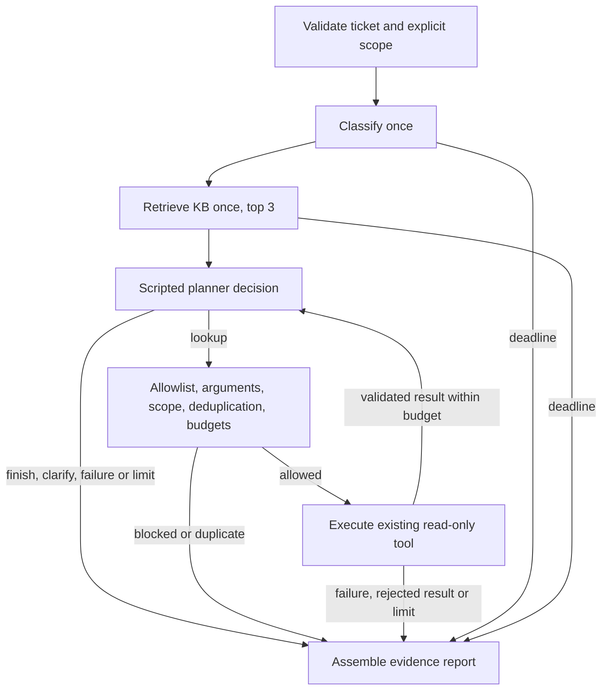

# Phase 4A: bounded, scripted investigation

This guide records Phase 4A behavior. [Phase 4B.1](phase4b1.md) now adds a live
planner and an explicit live CLI command; the scripted modes below are preserved.
[Phase 4B.2](phase4b2.md) adds optional synthesis after the investigation loop.

Phase 4A implements a local, read-only LangGraph workflow. It gathers and validates
evidence; it does **not** generate an investigation recommendation. Both CLI modes
use a supplied classification, a supplied query vector and scripted decisions.
No live planner, embedding, classification or synthesis model is called by this
workflow. The existing standalone Phase 1–3 commands remain available unchanged.

`human_review_required=true` is a mandatory review indicator. It is not an
implemented authorization check, approval queue, graph interrupt or pause/resume
mechanism. There is no persistence, checkpointer, background worker or automatic
escalation. `mutating_actions_executed=false` is always explicit. Read-only lookup
attempts have their own structured trace.

## Architecture and boundaries



Classification or retrieval failures are recorded and independent work continues.
No classification label decides identity, grants access or changes the KB query.
Retrieval uses the original ticket's subject and description through
`rag.recommendation.retrieve_ticket` → `kb.retrieval.search`. No embedding or
pgvector SQL is copied into the graph, and there is no distance threshold.

| File | Responsibility |
| --- | --- |
| `app/investigation/schemas.py` | Request scope, decisions, limits, typed evidence, lookup outcomes, final report |
| `app/investigation/graph.py` | TypedDict state, runtime dependencies, seven nodes, conditional edges, completion rules |
| `app/investigation/policy.py` | Fixed six-tool registry, existing Pydantic input/output validation, deterministic scope, canonical deduplication |
| `app/investigation/scripted.py` | Scripted planner/classifier/embedder and explicit fixture replay |
| `app/investigation/kb_access.py` | Restricted KB-only connection subclass; reuses `PgvectorStore` retrieval SQL; separate admin bootstrap |
| `app/investigation/cli.py` | Script loading, fixture/PostgreSQL selection, JSON output and exit codes |
| `examples/investigation-scripted.json` | Fictional, reproducible offline demonstration |
| `tests/investigation/` | Graph, CLI, failure, scope and real PostgreSQL boundary checks |

State contains the validated request, classification, KB/operational evidence,
trace, fixed error codes, counters, verified device IDs, deduplication keys,
deadline, pending lookup and final result. Runtime dependencies contain providers,
the planner, stores, limits and clock; credentials and clients are never state
fields or output fields. A planner receives a deep copy of its view, preventing it
from mutating application-owned scope or evidence.

LangGraph is the only new direct dependency (`>=1,<2`, locked at **1.2.16**).
It brings transitive packages including LangChain Core and LangSmith; this project
does not use prebuilt agents, provider wrappers or persistence APIs. External
LangSmith tracing is explicitly disabled around graph execution, even if enabled
in the invoking shell. See the official [Graph API](https://docs.langchain.com/oss/python/langgraph/graph-api)
for state, nodes, conditional edges and runtime context.

## Deterministic identifier scope

Structured request context is supplied by the local developer. It is **not**
authenticated identity or proof of authorization. The ticket itself still uses
the existing `TicketInput(subject, description)` contract.

| Identifier | Permitted source for subsequent calls |
| --- | --- |
| Employee | Only `request.employee_id`; never expanded during a run |
| Device | Only `device_id` values from a validated, successful `get_employee_devices` result for that exact employee |
| Software | Only the explicit `request.software_ids` allowlist, at most five unique IDs |
| Service | Only the explicit `request.service_ids` allowlist, at most five unique IDs; an unfiltered incident lookup is blocked |
| Ticket / incident / account | Evidence identifiers only; no tool accepts these as new investigation targets |

There is no direct device allowlist in the request: a device must first be verified
through the employee device-list lookup. The returned device owner is checked
again on a detail lookup. A changed or conflicting owner rejects that observation
and stops the loop; the previous device-list observation remains available for
human review. This does not establish a transaction spanning multiple lookups.

Names, employee manager links, entitlement approvers, device owners, historical
ticket relationships, incident prose, KB text and classification summaries never
expand scope. No ID extraction from free text is performed. Supplying another
employee's ID in a later request cannot bypass the gate. Existing operational
functions remain unchanged and independently usable outside this workflow.

The registry contains exactly:

- `get_employee_account_status(employee_id)`
- `get_employee_devices(employee_id)`
- `get_device_details(device_id)`
- `check_software_entitlement(employee_id, software_id)`
- `get_recent_support_tickets(employee_id, limit=5, since=None)`
- `get_active_service_incidents(service_id, limit=5)`

Argument validation rejects unknown fields, malformed IDs, naive timestamps and
coerced/non-integer limits. Agent list limits are at most five, even though the
standalone tools permit more. Deduplication uses the tool name plus sorted,
validated arguments, including defaults and UTC-normalized timestamp filters.
Blocked proposals are not executed. Unvalidated arguments and unknown tool names
are not echoed into the report.

## Bounds, evidence and outcomes

The defaults are hard upper bounds; a script may lower them:

| Bound | Value |
| --- | --- |
| Classification / retrieval | One attempt each; retrieval top 3 |
| Planner decisions | Four, including finish/clarify and failed decisions |
| Lookup attempts | Four; errors and rejected results count |
| Operational planner context | 24,000 serialized characters |
| Elapsed time | 120 seconds, checked between nodes and before clean completion |
| LangGraph recursion limit | 32 supersteps as a secondary backstop |
| Retries / repair / synthesis | None |

A normal completed run can use three lookups and its fourth decision to finish.
Four lookups without an explicit finish exhaust the decision budget and produce
a partial result. A duplicate or blocked request stops immediately. A context
overflow preserves the just-validated observation in the final report, but does
not send that enlarged context to another planner call. The character bound is a
planner-context bound, not a strict cap on the final JSON report.

The elapsed limit does not forcibly interrupt an in-flight Python call. Restricted
database connections have five-second connection/statement timeouts. These are
local safeguards, not a guaranteed overall wall-clock SLA.

KB evidence contains `kind=kb_chunk`, `chunk_id` and the full existing search
result: document ID, source path, title, section ID/path, chunk index, text, hash
and distance. Operational evidence contains `kind=operational_observation`, a
run-local `lookup_id`, tool name and its concrete existing Pydantic result.
Final validation checks that observation references resolve to the recorded tool
outcomes and that KB references match the returned chunks.

Operational results retain query, observation, update and historical event
timestamps, `data_kind=synthetic_snapshot`, and `live_verified=false`. A query
timestamp means the database was queried then, not that the underlying state was
verified then. Old account, device, ticket and incident records do not establish
current state. No automatic freshness threshold, causal diagnosis or conflict
resolution is implemented. Conflicting observations remain separate; historical
ticket resolutions do not become current company procedures.

`lookup_trace` records tool, normalized arguments when accepted, outcome, fixed
error code and evidence reference. `executed=true` means the tool function was
invoked, including attempts that failed before reading rows; it does not mean a
successful lookup. Blocked and duplicate proposals have `executed=false`.
`graph_trace` records node/outcome order, not private model reasoning.

## Completion and failure semantics

`completed` means the Phase 4A workflow reached explicit `finish` or `clarify`
with no errors or exceeded limits. It does not mean the ticket is resolved, the
evidence is sufficient, escalation is unnecessary, or an account/device is safe.

If there is a failure or limit, the result is `partial` when any validated
classification, KB chunk or operational observation is retained; otherwise it is
`failed`. Classification alone can therefore preserve a partial result, without
claiming an operational finding. The report includes exact errors and missing
components instead of fabricated replacements.

| Condition | Deterministic behavior |
| --- | --- |
| Invalid/oversized request | Reject before component calls; CLI setup error, exit 1 |
| Classification failure | Record `classification_failed`, keep classification null, continue retrieval and scripted planning |
| Retrieval/embedding failure | Record `retrieval_failed`, keep KB evidence empty, continue scripted planning |
| Empty successful retrieval | Empty evidence; no automatic recommendation or relevance claim |
| Unknown parent / no child rows | Preserve `not_found` or empty result; these are valid observations, not infrastructure failures |
| Blocked scope, bad arguments, unknown tool | Record non-executed outcome and reason; stop |
| Duplicate lookup | Record non-executed duplicate; stop |
| Database/tool failure | Record executed attempt with `lookup_failed`, no invented observation; stop |
| Malformed/mismatched tool result | Record rejected attempt, retain no evidence from that attempt; stop |
| Planner failure, malformed decision or script exhaustion | `planner_failed`; stop with earlier evidence intact |
| Decision, lookup, context or time limit | Record limit and stop; partial/failed follows retained evidence rule |
| Unexpected graph error | `graph_failed`; assemble from the most recent completed node's state |
| Synthesis | **Not run in Phase 4A.** `synthesis_status=not_run`, `recommendation=null` on every result |

Exceptions are replaced with fixed error codes, not raw provider/database
messages, stack traces or validation inputs. Process termination, memory
exhaustion, and bugs that also prevent fallback report assembly cannot guarantee
a recoverable report; there is no persistent state to resume.

For Phase 4B, a synthesis failure must preserve evidence, leave the recommendation
absent and make the run partial/failed under the same retained-evidence rule.
This is a future contract, not a claim of an implemented synthesis node or tested
live synthesis failure handling.

## Local CLI

Install the lockfile and run the offline example from the repository root:

```powershell
uv sync --locked --extra dev
uv run --locked python -m app.cli investigate scripted --script examples/investigation-scripted.json
```

The wrapper labels `backend=fixture`, `planner=scripted`,
`classification=scripted`, and `query_embedding=supplied_vector`. Fixture mode
replays supplied KB rankings through the existing retrieval entry point and
validates supplied operational results. It does not run semantic ranking or SQL.
The checked-in distances are illustrative fixture values, not evaluation results.

Recorded example trace:

```text
validate accepted
classify ok
retrieve ok                       3 KB chunks, full source metadata
plan lookup
guard allowed                     get_employee_devices(EMP-001)
execute ok                        lookup-1; DEV-001 and DEV-010 become eligible
plan lookup
guard allowed                     get_device_details(DEV-001)
execute ok                        lookup-2; owner matches EMP-001
plan finish
assemble completed                3 decisions, 2 read-only lookup attempts
```

The example returns no recommendation, `human_review_required=true` and
`mutating_actions_executed=false`. Exit codes are 0 for completed, 2 for partial,
and 1 for failed or setup errors. Redirect output to ignored `reports/` if needed.

For PostgreSQL mode, first finish the Phase 2/3 database setup. Provision a new
KB-only login using a separate, explicitly administrative bootstrap command:

```powershell
uv run --env-file .env.db python -m app.cli investigate provision-kb-reader
```

This writes a new ignored `.env.kb` containing `KB_READER_DATABASE_URL`. It neither
prints credentials nor overwrites an existing role/file. Reuse existing local
credentials when the role already exists; rotation is a separate administrative
operation. This command is not a graph node, planner action or allowlisted tool.
The existing `.env.ops` supplies `OPS_DATABASE_URL` for the separate ops-only role.

Prepare a **local** script with the same request/classification/decisions fields,
an `embedding_spec` matching the index, its 1536-dimensional `query_vector`, and
empty/omitted `kb_results` and `lookup_results`. Then:

```powershell
uv run --env-file .env.ops --env-file .env.kb python -m app.cli investigate scripted --backend postgres --script reports/investigation-postgres.json
```

This mode runs real pgvector search and the original six operational functions.
The supplied vector is bound to that script's exact ticket query, but the program
cannot prove how a developer generated it. Semantic quality requires a real
embedding for that ticket. Tests use artificial vectors **only in the separate
test database**, exercising ranking mechanics rather than semantic quality. Do
not replace application KB vectors with test vectors. No live embedding client is
connected by the Phase 4A CLI. PostgreSQL mode refuses replay result fields and
does not silently substitute fixture results or administrative credentials.

The KB reader has SELECT on `public.kb_chunks` only. The operations reader retains
SELECT on the eight ops tables only and cannot access the KB. Runtime audits reject
administrative roles, memberships, unexpected table/column grants, schema/database
creation privileges and accessible custom SECURITY DEFINER functions. The KB
subclass disables initialization/replacement methods as an additional guard.
Real permission tests turn off read-only defaults to check grants independently.

These checks are defense in depth for a local demonstration. They are not per-user
authorization, tenant isolation, an enterprise audit service or a general
PostgreSQL security audit. A credential holder can read all rows permitted to that
role outside this graph; the scope gate constrains graph dispatch, not direct SQL
clients. System catalogs and ordinary PUBLIC capabilities are not removed, and an
administrator can change grants and data. Local env files remain plaintext.

## Verification

```powershell
uv run --extra dev python -m pytest -m "not integration" --tb=short
uv run --env-file .env.db --extra dev python -m pytest --tb=short
```

`TEST_DATABASE_URL` must name a separate disposable database ending in `_test`,
different from the application database. New integration fixtures create and
remove unique reader roles and initialize only that test database. DSN fixture
representations are redacted. No paid API calls or API key access are needed.

Verification on 2026-10-21: **327 tests passed in 31.95 seconds**, preserving all **229 existing
tests** and adding **98 Phase 4A tests**: 79 offline and 19 real PostgreSQL checks.
The complete suite contains **263 offline + 64 integration tests**. Application
snapshots before and after the complete suite preserved all **79 operational rows
and 36 KB chunks**, including full serialized metadata and embeddings. Temporary
test reader roles were cleaned up. The scripted example CLI was also exercised.

Checks cover graph routing, all six tool contracts, exact scope, untrusted text,
historical/manager relationships, conflicting ownership, malformed and mismatched
outputs, deduplication including equivalent timestamp filters, limits, isolated
component failures, partial evidence, secret-free diagnostics, external tracing
disabled, CLI modes, restricted grants and unchanged database content. They do
not establish live planning quality, relevance, groundedness, end-user
authorization or real-system freshness.

Implementation verification found two test harness issues: incorrect provider
class names in a no-live-client assertion and a pytest module filename collision
with the existing CLI tests. Both were corrected. Final review also normalized
equivalent timestamp filters to UTC so they cannot bypass deduplication.

## Phase 4B boundary and design choices

At Phase 4A completion, the approved LLM-driven loop was represented by a small
planner protocol with only the scripted implementation connected. Phase 4B.1 now
adds the live planner through that interface; see the linked guide. No synthesis
adapter, synthesis prompt or recommendation evaluation change has been introduced.
The Phase 2B.1 schemas, prompts, evaluation data and reporting behavior are untouched.

After review of Phase 4B.1, a separately approved Phase 4B.2 can add a validated
synthesis adapter. The same deterministic gate must remain authoritative. Operational
observations and documented procedures must have separate typed references;
operational records cannot authorize undocumented troubleshooting, and valid
citation IDs cannot establish that a source supports a claim. Both summaries and
steps will need grounding checks and manual correctness review. Missing, stale
or conflicting observations must remain explicit. No mutation or unattended
escalation should follow a recommendation.

Refinements to the broad proposal are deliberate: devices require a preceding
employee-device lookup; software/service scope is explicit-only; blocked,
duplicate or failed lookups stop without a repair loop; and Phase 4A assembles an
evidence report instead of simulating a synthesized recommendation. Separate
KB-only provisioning was added to make PostgreSQL investigation read-only at the
credential boundary. No new infrastructure beyond the existing database is used.
